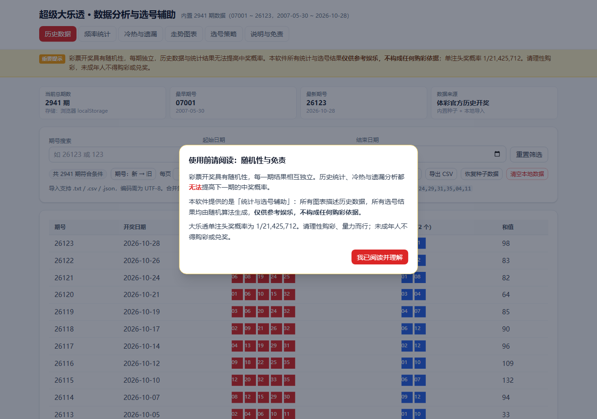
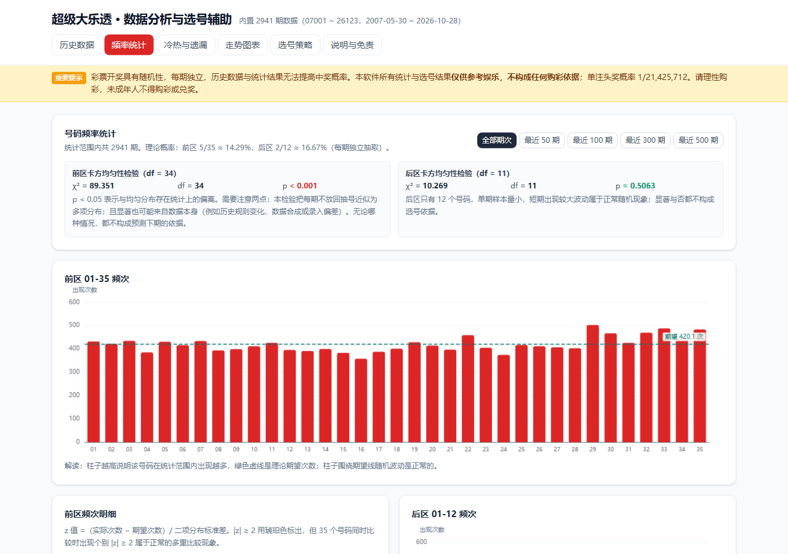
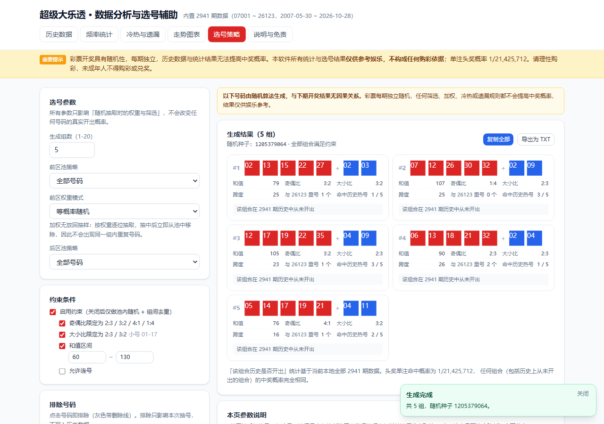

# 超级大乐透 · 数据分析与选号辅助

> **免责声明**：彩票开奖具有随机性，每期独立开奖，历史数据不影响下期概率。本软件所有统计结果与选号输出仅供参考娱乐，**不构成任何购彩依据**。单注头奖概率恒为 1/21,425,712，任何选号方法都无法提高这一概率。理性购彩，未成年人不得购彩兑奖。

基于 2,941 期历史开奖数据（2007-05-30 ~ 2026-10-28，期号 07001 ~ 26123）的前端分析工具。提供数据管理、频率统计、冷热与遗漏、走势图表、随机选号五项功能。

[](../../actions/workflows/ci.yml)

## 快速开始

**方式一：直接打开（无需环境）**

双击 `dist/index.html`，用浏览器打开即可。产物已改为经典脚本（IIFE）+ 相对路径，支持 `file://` 直接运行。原因见 [ADR 0001](docs/adr/0001-iife-classic-script-delivery.md)。

**方式二：开发模式**

环境要求：**Node.js ≥ 20**（推荐 22，见 `.nvmrc`）、**npm ≥ 10**。

```bash
npm ci             # 严格按 package-lock.json 安装
npm run dev        # 本地开发服务
npm run build      # 构建到 dist/
npx vitest run     # 运行测试（85 个用例）
```

## 开发脚本

| 脚本                    | 说明                                                    |
| ----------------------- | ------------------------------------------------------- |
| `npm run dev`           | 启动 Vite 开发服务器（热更新）                          |
| `npm run build`         | 构建到 `dist/`，产物可双击运行                          |
| `npm run preview`       | 本地预览构建产物（http 方式）                           |
| `npm run lint`          | 先跑文件规模守门脚本，再跑 ESLint（`--max-warnings 0`） |
| `npm run format`        | Prettier 格式化全部文件                                 |
| `npm run format:check`  | 只检查格式，不写入（CI 使用）                           |
| `npm run test`          | vitest 单次运行（85 个用例）                            |
| `npm run test:watch`    | vitest 监听模式                                         |
| `npm run test:coverage` | 覆盖率报告（仅统计 `src/lib`，含阈值校验）              |
| `npm run typecheck`     | 用 `jsconfig.json` 对 `src/lib` 做 JSDoc 类型检查       |
| `npm run verify:dist`   | 检查 `dist/` 是否仍满足「双击可运行」的 8 条断言        |

## 功能

| 模块       | 内容                                                                                                                                                                                                                |
| ---------- | ------------------------------------------------------------------------------------------------------------------------------------------------------------------------------------------------------------------- |
| 历史数据   | 内置 2,941 期种子数据；支持 TXT / CSV / JSON 导入（逐行校验、按期号去重合并）；搜索、日期区间筛选、分页、排序；导出 JSON / CSV；恢复种子 / 清空本地数据                                                             |
| 频率统计   | 前区 35 号、后区 12 号的出现次数、出现率、理论概率、偏差、z 值；频次柱状图含期望线；卡方均匀性检验（χ² 与 p 值）；可切换统计范围（全部 / 最近 50·100·300·500 期）                                                   |
| 冷热与遗漏 | 前后区冷热号 Top / Bottom；当前遗漏、平均遗漏、最大遗漏、上次出现期号；遗漏排行图                                                                                                                                   |
| 走势图表   | 号码分布热力图、和值走势（含理论均值 90 参考线）、奇偶比与大小比分布、五区间分布                                                                                                                                    |
| 选号策略   | 号码池（全部 / 热号 / 冷号 / 高遗漏 / 自定义）、权重模式（等概率 / 频率加权 / 遗漏加权 / 冷热混合）、奇偶比与大小比约束、和值区间、连号开关、排除号；加权无放回抽样，同种子可复现；每组标注该组合在历史中是否开出过 |
| 多期回测   | 用滚动窗口逐期检验策略：回测第 i 期只使用 i 之前的数据选号（无未来函数）；可与「纯随机基准」做两样本 z 检验；输出总投入、固定奖回收、回收率、各奖级命中、逐期明细，支持导出 CSV                                     |
| 说明与免责 | 玩法规则、数据来源、统计学局限说明、完整免责条款                                                                                                                                                                    |

## 多期回测口径

「多期回测」回答的是「如果按某策略买，历史上会怎样」，**不涉及任何下一期推断**。

| 口径       | 说明                                                                                                                                              |
| ---------- | ------------------------------------------------------------------------------------------------------------------------------------------------- |
| 无未来函数 | 回测第 i 期时只把第 i 期之前的数据交给策略，目标期号码不参与选号；频次与遗漏在该窗口内重新计算                                                    |
| 可复现     | 每期种子 = hash(总种子 : 期号)，同总种子 + 同参数 ⇒ 完全一致的结果                                                                                |
| 注数与成本 | 每期 1 / 3 / 5 / 10 注，每注 2 元；总投入 = 总注数 × 2                                                                                            |
| 奖级与金额 | 按官方规则判定 1–9 等奖；一、二等奖为浮动奖，只统计注数不计金额；固定奖按 3 等 10000、4 等 3000、5 等 300、6 等 200、7 等 100、8 等 15、9 等 5 元 |
| 随机基准   | 同期、同注数，用等概率随机选号跑 10 轮取均值，作为「策略是否有用」的对照组                                                                        |
| 显著性     | 前区平均命中与基准做两样本 z 检验（α=0.05）；p ≥ 0.05 表示与随机无法区分                                                                          |
| 复杂度     | 默认 100 期约 1 秒；500 期 × 5 注约 5–6 秒（每期都要在扩展窗口上重算频次与遗漏）                                                                  |

实测参考（全量 2,941 期，各自 100 期 / 5 注）：任意奖级命中率约 6%–8%，与理论值 6.67% 同量级；固定奖回收率长期在 20%–35%，远低于投入——这是返奖率约 51% 决定的，不是选号能改变的。

## 导入数据格式

TXT / CSV（分隔符可为 Tab、逗号、分号或连续空格，自动识别，可含表头）：

```
期号,开奖日期,前区1,前区2,前区3,前区4,前区5,后区1,后区2
26124,2026-10-31,03,11,19,25,33,02,07
```

JSON：

```json
{
  "meta": { "count": 1 },
  "draws": [{ "no": "26124", "date": "2026-10-31", "front": [3, 11, 19, 25, 33], "back": [2, 7] }]
}
```

校验规则：期号为 5 位；日期真实存在（支持 `YYYY-MM-DD`、`YYYY/M/D`、`YYYYMMDD`）；前区 5 个互不重复且 1-35；后区 2 个互不重复且 1-12。不合格行会被隔离并报出行号与原因，不影响其余数据。

## 技术栈与目录结构

Vite 5 + React 18 + Tailwind CSS 3 + ECharts 5，测试用 vitest 2。无 TypeScript 源码，纯逻辑层通过 JSDoc 做类型检查（见 [ADR 0002](docs/adr/0002-javascript-with-jsdoc-not-typescript.md)）。

```
src/
  features/
    generator/     选号面板（index + useGeneratorParams + 8 个展示组件）
  components/      其余面板（数据/频率/冷热/走势/回测/说明）与 ui 基础组件
    Ball.jsx Toast.jsx Chart.jsx EmptyHint.jsx
  lib/             纯逻辑（不依赖 React，可直接单元测试）
    parse.js       导入解析、逐行校验、去重
    stats.js       频次、遗漏、和值、奇偶/大小/区间、卡方 p 值
    generator.js   加权无放回抽样、约束校验、mulberry32 PRNG
    backtest.js    滚动窗口回测、奖级判定、随机基准、z 检验
    storage.js     localStorage 读写（不可用时降级为内存）
    format.js      格式化工具
    download.js    浏览器下载（Blob + a[download]）
  data/            内置种子数据（唯一数据源，每期一行）
tests/
  unit/            lib 与回测单元测试（48 用例）
  acceptance/      QA 全量验收测试（37 用例，含全量基准核对）
scripts/           构建/守门脚本（verify-dist、check-file-size、format-seed-data）
docs/
  adr/             架构决策记录
  screenshots/     精选验收截图（README 引用）
.github/           CI、Release、Issue 模板、CODEOWNERS、dependabot
dist/              构建产物（可直接双击打开；不入库，走 CI artifact / Release）
```

**硬约定：业务代码必须在 `src/` 之下、扩展名限 `.js` / `.jsx`。** `tailwind.config.js` 的 `content` 是 `./src/**/*.{js,jsx}`，把组件移出 `src/` 或改成 `.tsx` 会让样式静默丢失（页面变丑但构建成功）。

## 交付物与 `file://` 说明

`npm run build` 产出的 `dist/` 是**可直接双击运行的交付物**，无需 Node、无需本地服务器。三条关键设计：

1. **`base: './'`**：所有资源引用都是相对路径，`file://` 下不会因绝对路径 `/assets/...` 解析到磁盘根目录而 404。
2. **`format: 'iife'` + `inlineDynamicImports: true`**：产物是单个经典脚本，不含顶层 `import` / `import.meta`；浏览器对 `file://` 下的 `<script type="module">` 有 CORS 限制（origin 为 `null`），用 module 会白屏。
3. **`classicScriptPlugin`**：把 `<script type="module" crossorigin>` 改写为 `<script defer>`，并去掉 `crossorigin` 属性。

**这三条互为条件，任何一条被「优化」掉都会让用户端白屏，而开发模式完全正常 —— 属于最难发现的回归。** 因此 `npm run verify:dist` 用 8 条断言把它钉死，CI 每次构建都会跑。详见 [ADR 0001](docs/adr/0001-iife-classic-script-delivery.md)。

## 数据更新流程

种子数据是 `src/data/dlt_history.json`，唯一数据源。更新步骤：

```bash
# 1) 编辑 JSON（draws 数组里每期一条记录，字段 no / date / front / back 不可改名）
# 2) 整形并自校验（脚本会先备份为 .bak，然后校验 JSON.parse 后深度相等）
node scripts/format-seed-data.mjs
# 3) 三连验
npx vitest run          # acceptance 里 37 个用例含全量基准核对，字段或数值错会立刻红
npm run build
npm run verify:dist
```

**注意事项**：`meta` 与 `draws` 结构不可变，不要改成 JSONL 或拆多文件（`App.jsx` 单 import + 验收测试 `readFileSync` 都依赖它）；`src/data/**/*.json` 已排除在 Prettier 之外，请勿手工「美化」成多行缩进格式 —— 逐期一行是脚本产物的约定格式，见 [ADR 0003](docs/adr/0003-seed-data-inline-import-and-one-draw-per-line.md)。

## 数据来源

中国体彩网官方开奖数据接口 `webapi.sporttery.cn`（gameNo=85），抓取时间 2026-10-30。详见 [NOTICE.md](NOTICE.md)。

数据层面的事实说明：前区频次经卡方检验偏离均匀（χ²=89.35，df=34，p<0.001），号码 29-35 偏多、16-17 偏少；后区均匀（χ²=10.27，df=11，p=0.506）。**该偏差不足以构成选号依据**，且其中可能包含历史规则变化或数据本身的因素，软件内已在对应位置注明。

## 截图

| 首次进入的免责确认                              | 频率统计                                       |
| ----------------------------------------------- | ---------------------------------------------- |
|  |  |

| 选号结果                                              | 移动端选号                                          |
| ----------------------------------------------------- | --------------------------------------------------- |
|  |  |

## 已知限制

- 后区权重固定为等概率，仅受号码池策略与排除号影响
- 热力图在 100 期视图下格子较扁，超过 300 期自动加高
- 浏览器禁用 localStorage（隐私模式）时数据退化为内存存储，刷新后丢失
- 回测的 500 期档位需 5–6 秒，计算期间界面会短暂无响应（单线程同步计算）
- 构建产物体积约 1.4MB 是设计结果（IIFE 单文件 + 内联动态导入），不是缺陷

## 贡献

见 [CONTRIBUTING.md](CONTRIBUTING.md)。安全问题请按 [SECURITY.md](SECURITY.md) 报告。

## 许可证

[MIT](LICENSE) · 数据来源与合规边界见 [NOTICE.md](NOTICE.md)。
