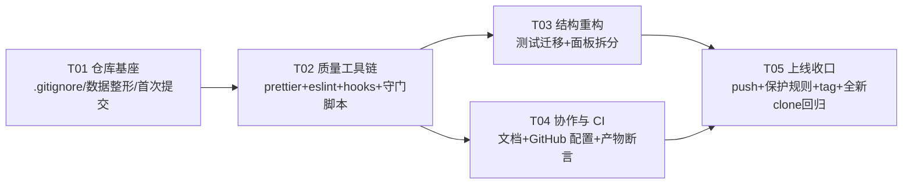

# dlt-predictor GitHub 工程化优化方案与实施清单

> 版本：v1.0 ｜ 架构：高见远 ｜ 基线实测时间：项目本地 Node v22.22.2 / npm 10.9.7
> 适用对象：`D:/.workbuddy/2026-10-30-14-39-26/dlt-predictor`（Vite 5 + React 18 JSX + Tailwind 3 + ECharts 5 + vitest 2，无 TypeScript）
> **不可破坏约束（全文最高优先级）**：`npm run build` 产物 `dist/` 必须保持「双击 `dist/index.html` 用 `file://` 直接打开可运行」。任何改动若破坏此条即为回退级缺陷。

---

## 0. 现状核实结论（本方案全部依据，均已本机实测）

| 项 | 实测结果 | 采集方式 |
|---|---|---|
| 版本控制 | `git rev-parse` → `fatal: not a git repository`，无 `.git`、无 `.gitignore`、无任何提交 | `git rev-parse --is-inside-work-tree` |
| 工程规范 | `package.json` 中无 eslint / prettier / husky / lint-staged；无 `.editorconfig`；scripts 仅 `dev/build/preview/test` 4 条 | 读 `package.json` |
| CI/CD | 无 `.github/` 目录 | `ls -a` |
| 开源合规 | 无 `LICENSE` / `CHANGELOG` / `CONTRIBUTING` / `SECURITY` / `NOTICE` | `ls` |
| 源码规模 | `src` 23 文件 / 6393 行；最大 `GeneratorPanel.jsx` 715 行，>450 行共 4 个文件 | `wc -l` |
| 测试 | 3 文件 / **85 用例 / 2.91s 全绿**（lib 30 + backtest 18 + qa 37），全部位于 `src/lib/` 业务目录 | `npx vitest run` |
| 构建 | **13.19s**（vite 5.4.21），产物 `index.html` 0.46kB + `style.css` 28.31kB + `app.js` 1455.85kB（gzip 459.73kB） | `npm run build` |
| 产物形态 | `dist/index.html` 中 `type="module"` 命中 0、`crossorigin` 命中 0；`app.js` 首字节为 `(function(){"use strict";` | `grep` + `head -c` |
| 野生大文件 | `node_modules` 118M、`dist` 1.5M、`qa_shots` 2.3M（15 张）、`大乐透...可运行版.zip` 467KB | `du -sh` |
| **重复数据** | 根 `data/dlt_history.json` 与 `src/data/dlt_history.json` **同尺寸 212722 字节双份**，唯一 import 源是 `src/App.jsx:2` | `ls -la` + `grep -rn dlt_history src/` |
| 数据格式 | 单行 212690 字节，diff 不可读 | `head -c` |
| 依赖范围 | 全部 `^` 浮动，无 `engines`；有 `package-lock.json`（好） | 读 `package.json` |
| JSDoc 存量 | `src/lib` 6 个纯逻辑文件共 **188 处 `@param/@return`**（stats 51 / generator 38 / backtest 29 / parse 27 / storage 23 / format 20） | `grep -c` |
| Tailwind | `content: ['./index.html', './src/**/*.{js,jsx}']` —— **src 下任意新子目录自动纳入**，但 src 之外会漏 | 读 `tailwind.config.js` |
| 工具链缺口 | `gh` CLI 未安装（`gh: command not found`），推 GitHub 需另装或走 PAT | `gh --version` |

---

## 1. 优化目标与适用范围

### 1.1 可度量目标（基线 → 目标）

| 编号 | 目标 | 当前基线（实测） | 目标值 | 度量方式 |
|---|---|---|---|---|
| G1 | 静态检查零问题 | 无 lint，6393 行 0 检查 | `eslint . --max-warnings 0` 退出码 0；`prettier --check .` 退出码 0 | CI `lint` job 强制 |
| G2 | 回归自动化 | 85 用例需人工 `npx vitest run` | 每次 push/PR 自动跑，85/85 绿，耗时 ≤10s；`src/lib` 行覆盖 ≥80%（先测基线再定） | CI `test` job |
| G3 | 交付特性守门 | 靠人记忆「改完双击试一下」 | CI 对产物执行 **8 条断言**（见 §3.4），全绿才可合并 | CI `verify-dist` job |
| G4 | 仓库体积 | 无 git；一旦 `git add .` ≈ **122MB** | 首次 clone **≤2.5MB**，且永不包含 `node_modules/dist/*.zip/qa_shots` | `git count-objects -vH` 后逐 clone 验证 |
| G5 | 单文件规模 | 最大 715 行（GeneratorPanel），>450 行 4 个 | 业务文件 **≤300 行**、测试 ≤400 行；超限 CI 失败 | `scripts/check-file-size.mjs` |
| G6 | 可追溯性 | 0 条提交历史 | 每个改动单元独立 commit + Conventional Commits + `CHANGELOG.md` + `v1.1.0` tag | `git log --oneline` / Release 页 |
| G7 | 上手成本 | 23 个 src 文件 + 0 篇规范，需通读 ~6400 行 | 4 类文档（README / CONTRIBUTING / ADR×3 / CHANGELOG）+ 目录约定，阅读量 ≤1200 行 | 文档清单 + 目录树 |

### 1.2 明确不做（范围外）及理由

| 不做事项 | 理由 |
|---|---|
| **不迁移 TypeScript** | 6393 行 JSX 全量重写类型风险极高、收益滞后；且 lib 层已有 188 处 JSDoc，用 `checkJs` 只覆盖 `src/lib`（见 A7）即可拿到 80% 收益、0 交互风险。迁移另立 ADR 与独立议题。 |
| **不做代码分割 / 拆 chunk** | `vite.config.js` 的 `inlineDynamicImports: true` + `format: 'iife'` 是双击可运行的必要条件，chunk 分离与 IIFE 单文件互斥。**故 1455.85kB 单包是设计结果，不是缺陷**，`chunkSizeWarningLimit: 1600` 已豁免。 |
| **不改任何统计/选号算法** | 85 个用例已固化当前口径（卡方、遗漏、超几何、z 检验、mulberry32）。算法变更需 Product 立项，不属于工程化范围。 |
| **不做视觉改版** | 与工程化无耦合；Tailwind 类名大规模重排会让 PR diff 失去可审性。 |
| **不引入后端 / 数据库 / 账号体系** | 产品定位是「数据仅存本地浏览器」的离线单页工具，加后端会引入隐私与合规负担（彩票主题尤其敏感）。 |
| **不做 E2E（Playwright 全量）为重点** | `file://` 双击路径用无头浏览器覆盖成本高且不稳定；改用 **产物静态断言（8 条）** 作为主门，Playwright 仅作 P2 可选增强。 |
| **不引入 commitlint 强制（首版）** | 单人提交，硬性 commit-msg 拦截收益低于误伤成本；先定规范（D2），P2 再上钩子。 |
| **不锁死依赖精确版本** | 有 `package-lock.json` + CI 用 `npm ci` 已足够可复现；锁死精确版本会阻断 dependabot 补丁流（见 B7）。 |

---

## 2. 改进清单

> 优先级：P0 = 不做则后续全塌 / 立刻产生风险；P1 = 本次交付必须完成；P2 = 二期可延后。
> 工作量单位：小时（单人，含自测）。

### A. 代码质量

| 编号 | 改进项 | 当前问题（证据） | 具体做法 | 优先级 | 工作量 | 预期收益 |
|---|---|---|---|---|---|---|
| A1 | ESLint 9 flat config 落地 | `package.json` 无 eslint 字段；全项目 0 处 lint 配置；6393 行无静态检查 | 装 `eslint@^9` `@eslint/js` `globals` `eslint-plugin-react` `eslint-plugin-react-hooks` `eslint-config-prettier`；新增 `eslint.config.js`。规则集 = `js.configs.recommended` + `plugin:react/recommended` + `rules-of-hooks: 'error'` + `exhaustive-deps: 'warn'`（首版）；`ignores: ['dist/**','node_modules/**','coverage/**','*.zip']`；`vite.config.js`/`eslint.config.js`/`scripts/**` 单独一组 `languageOptions.globals = globals.node`；末尾 `eslintConfigPrettier` 关闭格式类规则；`npm run lint = eslint . --max-warnings 0`（待 A1b 清完 warn 后启用） | P0 | 3 | 抓出 `no-undef`、误用 hooks（7 个面板大量 `useMemo/useState`，hooks 顺序错误是白屏级风险） |
| A1b | 规则集选型与 warn 清零 | 若首版直接上 `exhaustive-deps: error` 极可能立即红，阻塞后续 | 先 `npx eslint . -f json > /tmp/lint.json` 统计 `warningCount`；逐条修（多为补稳定依赖项或加 `useMemo` 边界）；清零后把 `exhaustive-deps` 提到 `'error'` 并启用 `--max-warnings 0`。**不选 airbnb**（需 eslint 8 peer，且 `prop-types` 等规则与 React 18 现代写法冲突、噪音大）；**不选 xo/standard**（无法对 `vite.config.js` 做精细豁免） | P1 | 3 | 零噪音可维护规则集，避免「装了 lint 但没人跑」 |
| A2 | Prettier 3 统一格式 | 无 `.prettierrc` / `.editorconfig`，缩进靠人工 | 装 `prettier@^3`；`.prettierrc.json`：`{ singleQuote: true, semi: true, printWidth: 100, trailingComma: 'all', arrowParens: 'always' }`；`.prettierignore` 必须包含 `dist` `node_modules` `package-lock.json` **`src/data/**/*.json`** `qa_shots` `*.zip`。**执行顺序**：先 `prettier --check .` 拿到文件清单 → 再 `prettier --write .` → 单独 commit `chore: 应用 prettier 格式化（无逻辑变更）`。禁止与逻辑改动混提 | P0 | 2 | 消灭「格式差异」类 diff 噪音，为后续所有 diff 提供可审性 |
| A3 | git hooks（husky 9 + lint-staged 15） | 无 `.husky`；提交无任何本地门 | `npm i -D husky@^9 lint-staged@^15` → `npx husky init` → `.husky/pre-commit` 内容 `npx lint-staged`；`package.json` 加 `"lint-staged": { "*.{js,jsx}": ["eslint --fix --max-warnings 0", "prettier --write"], "*.{json,md,css,yml,yaml}": ["prettier --write"] }`。**依赖 A1/A2 完成**（否则无规则可跑）。commit-msg 钩子留 P2（D2） | P1 | 1.5 | 问题在本地拦截，不进 PR；CI 红率下降 |
| A4 | 测试目录重组 | 3 文件 1235 行散在 `src/lib/` 业务目录；`qa.test.js` 635 行是 QA 验收产物混在实现层；其中用 `path.resolve(HERE, '../data/dlt_history.json')` 依赖当前位置 | 目标结构：`tests/unit/lib.test.js`、`tests/unit/backtest.test.js`、`tests/acceptance/qa.test.js`；`vite.config.js` 的 `test.include` 改 `['tests/**/*.test.{js,jsx}']`，并加 `resolve.alias { '@': path.resolve(__dirname,'src') }`；三文件 import 统一改 `@/lib/*.js`；`qa.test.js` 的 `SEED_PATH` 改 `path.resolve(HERE, '../../src/data/dlt_history.json')`。**必须 `git mv` 保留历史** | P1 | 2 | 生产代码目录零测试噪音；验收测试与单元测试职责分离 |
| A5 | `GeneratorPanel.jsx`（715 行）拆分 | 单文件 715 行，含常量、2 个 UI 子组件 + 1 个 GroupCard + 主组件 + `downloadText` | 拆为 `src/features/generator/` 下 6 个文件（详见 §2.1）；每文件 ≤190 行；**先纯搬运 + 原地 `export { default } from './features/generator/index.jsx'` 兼容，再删旧文件**（分两个 commit） | P1 | 5 | 单文件可读性、可测试性、diff 冲突面显著下降 |
| A6 | 其余超限文件拆分 | `BacktestPanel` 453 / `DataManager` 451 / `Stats`?no / `stats.js` 419 / `parse.js` 410 / `backtest.js` 394 / `TrendPanel` 356 / `HotColdPanel` 313 / `FrequencyPanel` 265 —— 共 8 个 >300 行 | 按 §2.2 目标拆分（P2 分期）；每拆一个单独 commit + 85 测试回归 | P2 | 8 | 全仓业务文件 ≤300 行，G5 达成 |
| A7 | 类型检查折中（JS + JSDoc，仅 lib） | 无 TypeScript / 无类型检查；但 `src/lib` 已有 188 处 JSDoc 可直接被利用 | 装 `typescript@^5.6`；新增 `jsconfig.json`：`{ compilerOptions: { allowJs: true, checkJs: true, noEmit: true, target: 'ES2022', module: 'ESNext', moduleResolution: 'bundler', strict: false, resolveJsonModule: true }, include: ['src/lib/**/*.js'], exclude: ['**/*.test.js'] }`；`npm run typecheck = tsc -p jsconfig.json`。**首版 `strict:false` 只求 0 error**，后逐步开 `noImplicitAny` 等。React 侧完全不动 | P2 | 4 | 纯逻辑层拿到 80% 类型收益，0 迁移风险；188 处 JSDoc 从注释变成契约 |
| A8 | 文件规模守门脚本 | G5 无任何自动约束，拆完会重新长回去 | 新增 `scripts/check-file-size.mjs`：遍历 `src/**/*.{js,jsx,css}`，业务文件 >300 行 / `tests/**` >400 行则 `exit 1` 并打印 `文件: 行数 (阈值)`；白名单首版含 `src/components/GeneratorPanel.jsx`（A5 完成后移除）；接入 `npm run lint` 之前执行 | P1 | 1 | 防止复杂度回潮，可执行的架构约束 |
| A9 | 测试脚本补全 + 覆盖率基线 | scripts 仅 `test: vitest run`；无 watch、无覆盖率 | 装 `@vitest/coverage-v8`；scripts 增 `test:watch: vitest`、`test:coverage: vitest run --coverage`；首次测出 `src/lib` 行覆盖率基线（预计已较高，因 85 用例覆盖全量基准），据此把 G2 的 80% 写成硬指标 | P1 | 1.5 | 覆盖率可量化，重构时敢动 |

#### 2.1 `GeneratorPanel.jsx` 拆分方案（A5 明细）

| 新文件 | 职责 | 来源行区间（原文件） | 预估行数 |
|---|---|---|---|
| `src/features/generator/constants.js` | 4 组选项常量 + `DEFAULT_UI_PARAMS` | 8–50 | ~45 |
| `src/features/generator/NumberToggleGrid.jsx` | 号码开关网格（前区/后区、池/排除双模式） | 69–112 | ~55 |
| `src/features/generator/CheckboxRow.jsx` | 带 hint 的复选行 | 113–134 | ~28 |
| `src/features/generator/GroupCard.jsx` | 单组结果卡片（含历史开出标注） | 135–193 | ~62 |
| `src/features/generator/useGeneratorParams.js` | `params/seedInput/result/lastSeed` 状态 + 全部 onChange/校验/生成调用 | 194–194 之后的 hook 与 handler 段 | ~95 |
| `src/features/generator/index.jsx` | 主组件：布局 + 结果区 + 导出按钮 | 剩余 JSX | ~185 |
| `src/lib/download.js` | `downloadText()` 提为公共（BacktestPanel 也在用导出） | 52–68 | ~22 |

合计 ≈ 492 行（含 import 与空行），最大单文件 185 行。产物仍单文件（rollup 会把多模块 inline 进 IIFE），**`dist/assets/app.js` 体积不应有实质变化（±2% 内为正常，>5% 需查是否引入重复依赖）**。

#### 2.2 其余文件拆分目标（A6，P2）

| 现文件（行数） | 拆分后 | 单文件上限 |
|---|---|---|
| `DataManager.jsx`（451） | `src/features/data/ImportPanel.jsx` / `DrawTable.jsx` / `DataToolbar.jsx` / `index.jsx` | ≤200 |
| `BacktestPanel.jsx`（453） | `src/features/backtest/useBacktest.js`（计算与状态）/ `BacktestResult.jsx` / `index.jsx` | ≤200 |
| `TrendPanel.jsx`（356） | `src/features/trend/chartOptions.js`（ECharts option 工厂）/ `TrendPanel.jsx` | ≤220 |
| `HotColdPanel.jsx`（313）、`FrequencyPanel.jsx`（265） | 同构抽出 `chartOptions.js` | ≤220 |
| `lib/stats.js`（419）、`lib/parse.js`（410）、`lib/backtest.js`（394） | 按职责切 `stats/frequency.js`+`stats/omission.js`+`stats/chiSquare.js`；`parse/text.js`+`parse/json.js`+`parse/validate.js`；`backtest/run.js`+`backtest/prize.js`+`backtest/benchmark.js`，各自 `index.js` re-export 保持路径兼容 | ≤250 |

### B. 项目结构

| 编号 | 改进项 | 当前问题（证据） | 具体做法 | 优先级 | 工作量 | 预期收益 |
|---|---|---|---|---|---|---|
| B1 | `.gitignore` 先落地 | 无 `.gitignore`；`node_modules` 118M / `dist` 1.5M / `qa_shots` 2.3M / zip 467KB 全裸露；一次 `git add .` ≈ 122MB | 仓库根新增 `.gitignore`，内容见 §2.3。**必须在 `git init` 与首次 commit 之前完成**，且首次 `git add` 后用 `git status --short \| wc -l`（预期 <35）与 `git count-objects -vH`（预期 size <2MB）复核 | P0 | 0.5 | 仓库从 122MB → ≤2.5MB；这是「先决条件」级改进 |
| B2 | 清理根目录重复数据 | 根 `data/dlt_history.json` 与 `src/data/dlt_history.json` 同为 **212722 字节双份**；唯一 import 是 `src/App.jsx:2` | 先 `grep -rn "\.\./data/\|'\./data/" src/` 确认为空 → 删除根 `data/` 目录；**保留 `src/data` 为唯一数据源**。`qa.test.js` 的 `'../data/dlt_history.json'` 是相对 `src/lib` 解析，指向 `src/data`，不受影响 | P0 | 0.25 | 消除「改错副本」隐患，仓库少 208KB |
| B3 | 200KB 单行 JSON 的 diff 友好化 | `src/data/dlt_history.json` 单行 212690 字节，任何改动 diff = 删 1 行 + 加 1 行，无法审 | 新增 `scripts/format-seed-data.mjs`：读取后输出 `{"meta":{...},` 独占首行 + `"draws":[\n` + **每期一行** `{...},\n` + `]}`。**实测结果：215634 字节（+1.4%）、2945 行、`JSON.parse` 通过、首条记录不变** → import 路径与 `import seedJson from './data/dlt_history.json'` 写法完全不变。新增 `.gitattributes`：`* text=auto eol=lf`、`src/data/dlt_history.json linguist-generated=true`（GitHub 上默认折叠 diff）。**禁止**改 JSONL / 拆多文件 / 去 meta（会破 `App.jsx:2` 单 import 与 `qa.test.js` 的 `readFileSync + JSON.parse`） | P0 | 1 | 数据变更可精确定位到期号；`git blame` 可用 |
| B4 | 目录约定 | `src` 下仅 `lib/components/data`，7 个面板与 4 个基础组件混在一层 | 目标：`src/features/<domain>/{index.jsx,...}`（generator/data/backtest/trend/frequency/hotcold/about）、`src/components/ui/`（Ball/Toast/Chart/EmptyHint）、`src/lib/`（纯逻辑，零 React）、`src/data/`、`tests/{unit,acceptance}`、`scripts/`、`docs/{adr,screenshots}`、`.github/{workflows,ISSUE_TEMPLATE}`。**硬约定：业务代码必须在 `src/` 之下**（因 `tailwind.config.js` content 为 `./src/**/*.{js,jsx}`，移出 src 会导致样式静默丢失） | P1 | 2 | 新人按目录即可定位；Tailwind 与构建路径零配置跟随 |
| B5 | 构建产物与交付物归置 | `dist/`（1.5M）与 zip（467KB）是产物却与源码同级；`qa_shots/`（2.3M/15 张）混在根目录 | `dist/`、`*.zip`、`qa_shots/` 全部入 `.gitignore`；从 15 张验收截图中挑 **4 张**（`01-first-load-modal` / `03-tab-2-频率统计` 或 `05-generator-result` / 回测结果 / `07-mobile-generator`）迁入 `docs/screenshots/` 并入库供 README 引用，其余不入库；`dist` 通过 CI artifact 与 Release 附件分发（§3.4、§3.5） | P1 | 1 | 仓库只装「人写的」，产物走 Release；二进制永不进 diff |
| B6 | `engines` 与 scripts 补全 | 无 `engines` 字段（实测 Node v22.22.2，CI 拟用 20/22 无声明依据）；scripts 仅 4 条 | `package.json` 加 `"engines": { "node": ">=20.0.0", "npm": ">=10" }`；根新增 `.nvmrc` = `22`；scripts 补 `lint` / `format` / `format:check` / `test:watch` / `test:coverage` / `typecheck` / `verify:dist` | P1 | 0.5 | 环境不一致类问题在 `npm i` 阶段即暴露（EBADENGINE） |
| B7 | 依赖范围策略定论 | 全部 `^` 浮动；无审查流程 | **保留 `^`**：`package-lock.json` 已锁实际版本，CI 一律用 `npm ci`（严格按 lock 安装）；配合 dependabot（D7）领取补丁。不引入 `npm audit` 硬门（审计噪声高、易误伤构建），改为 dependabot 告警 + 人工按需 `npm audit` | P1 | 0.25 | 可复现 + 可升级两者兼得 |

#### 2.3 `.gitignore` 内容（B1 交付物）

```gitignore
# 依赖
node_modules/
# 构建产物（走 CI artifact / Release 分发）
dist/
dist-*.zip
*.zip
# 验收截图原始目录（精选图另存 docs/screenshots/）
qa_shots/
# 覆盖率与缓存
coverage/
.vitest-before.json
.eslintcache
# 环境与编辑器
.env
.env.*
!.env.example
.DS_Store
Thumbs.db
.idea/
.vscode/*
!.vscode/extensions.json
# 临时
*.log
tmp/
```

### C. 文档完善度

| 编号 | 改进项 | 当前问题（证据） | 具体做法 | 优先级 | 工作量 | 预期收益 |
|---|---|---|---|---|---|---|
| C1 | README 补节 | 101 行、8 个二级标题；无徽章、无环境要求、无脚本表、无贡献指引、无许可证节、目录结构与实际不符（未含 `tests/`、`scripts/`） | 顶部加 CI 徽章（私有库徽章需在 README 用相对路径 `../../actions/workflows/ci.yml/badge.svg`）+ Node 版本要求；新增「开发脚本」表（7 条 scripts 逐条说明）；「目录结构」更新为目标树；新增「交付物与 file:// 说明」节，用 3 行解释 IIFE/`base:'./'` 的**目的**并链到 `docs/adr/0001`；新增「数据更新流程」（`scripts/format-seed-data.mjs` + 校验）；末节加「许可证 MIT」链接；**现有第 5 行免责声明保持在前 3 行以内不动** | P1 | 2 | 新人 10 分钟可跑通；合规声明保持最显眼 |
| C2 | CHANGELOG.md | 无 | 采用 **Keep a Changelog 1.1.0 + SemVer**，手工维护；首版写：`1.0.0`（当前已交付功能，2026-10-30）、`Unreleased → 1.1.0`（本次工程化：Added/Changed/Internal，无 API 破坏故为 minor）。**不引入 standard-version / semantic-release**：单人项目里自动语义化依赖 commit 前缀质量，收益低于额外依赖与配置成本；仅在 `gh release create --generate-notes` 时把自动清单当草稿参考 | P1 | 1.5 | 「交付给用户的到底是哪个版本」可追溯 |
| C3 | CONTRIBUTING.md | 无贡献指引 | 含：环境（Node ≥20 / npm ≥10）、安装与脚本、分支命名（D1）、commit 规范（D2）、PR 要求（D3）、**代码风格**（prettier + eslint，禁手改 `src/data/*.json` 结构）、**交付物硬门（改动 `vite.config.js` / `package.json` / `index.html` 者，PR 必须附「双击 dist/index.html 通过」的截图）**、测试要求（新增逻辑须带用例，85 基线不得减少）、合规红线（禁「预测/提高中奖率」类表述） | P1 | 1.5 | 协作规则从「口口相传」变为可引用文本 |
| C4 | LICENSE 选型 | 无 | 候选对比见 §2.4。**推荐 MIT** + 另建 `NOTICE.md`（数据来源与合规边界）。理由：私有库也建议有 LICENSE（未来开源零改动）；MIT 最短、最常见、对「学习/复用」最友好；Apache-2.0 的专利条款对本项目是过度设计。**合规要点：LICENSE 正文只写通用许可条款，绝不写任何与彩票效果相关的表述**；数据来源与「不构成投注建议」写入 NOTICE + README | P1 | 1 | 法律边界清晰；避免「无证软件」被误当投注工具传播 |
| C5 | 架构决策记录 ADR | 无任何决策记录；IIFE 插件是「反直觉」代码，最易被后人当冗余删掉 | 新增 `docs/adr/`：`0001-iife-classic-script-delivery.md`（**P1 必写**：问题=CORS/`file://`，决策=IIFE + `base:'./'` + 去 `crossorigin`，后果=禁代码分割、禁 `type=module`，验证=`scripts/verify-dist.mjs`）、`0002-javascript-with-jsdoc-not-typescript.md`、`0003-seed-data-inline-import-and-one-draw-per-line.md`。模板：Context / Decision / Consequences / Enforcement | P1 | 2 | 防「好心优化」造成白屏级回归；新人是非题有据可查 |
| C6 | SECURITY.md | 无 | 声明：无后端、无账号、无密钥、数据仅存浏览器 localStorage；漏洞报告走 GitHub Security Advisory（私有库可用）；非安全问题（数据准确性争议）请引用官方开奖公告 | P2 | 0.5 | 安全预期明确，减少无意义 issue |

#### 2.4 LICENSE 候选对比（C4）

| 候选 | 适合度 | 理由 | 风险点 |
|---|---|---|---|
| **MIT（推荐）** | ★★★★★ | 28 行、最通用；允许他人学习/复用统计实现；私有库亦可先放，未来开源零改动 | 无专利授权条款（对纯前端统计工具影响可忽略） |
| Apache-2.0 | ★★★☆ | 含明确专利授权与商标条款，企业法务友好；含 NOTICE 机制 | 篇幅长、需维护 NOTICE；对本项目属过度设计 |
| 专有 / All rights reserved | ★★ | 若明确不希望被复用 | 与「未来可能开源」目标冲突；仍建议写一份 `LICENSE` 声明著作权，避免「无证」状态 |

**彩票主题合规措辞三原则（写入 LICENSE 之外的 NOTICE/README）**：① 只描述「历史数据的统计展示 + 随机选号辅助」；② 明示「不提供投注、代购、兑奖服务，不构成购彩依据」；③ 保留「单注头奖概率 1/21,425,712，任何方法都无法提高」原句。

### D. 协作流程

| 编号 | 改进项 | 当前问题（证据） | 具体做法 | 优先级 | 工作量 | 预期收益 |
|---|---|---|---|---|---|---|
| D1 | 分支模型（trunk-based lite） | 无 git，无模型 | `main` 常绿（受保护）；日常用短生命周期分支 `feat/*` `fix/*` `chore/*` `docs/*`，合并后即删。允许单人直接 push `main`（有 CI 守门），**但 `vite.config.js` / `index.html` / `package.json` / `.github/**` 的改动必须走 PR**（这四类是交付特性与流水线本体）。**不采用 GitFlow**：单人无 `develop`/`hotfix` 双轨必要，只会增加合并成本 | P1 | 0.5 | 流程与人数匹配；关键文件被强制审阅 |
| D2 | Conventional Commits | 无 commit 规范 | 采用 Conventional Commits 1.0.0；type 白名单 `feat fix chore docs refactor test build ci perf`；scope 建议 `generator/data/backtest/trend/stats/ci/deps`；**允许中文 subject**（`feat(generator): 拆分选号面板为 6 个文件`）。P2 再加 `@commitlint/cli` + `config-conventional` 挂 `commit-msg` 钩子 | P1 | 1 | `git log` 即变更史；为将来自动 changelog 留接口 |
| D3 | PR 模板 | 无 | `.github/pull_request_template.md` 要素：关联 issue / 变更类型勾选 / **检查清单（`npm run lint` ✅ `npx vitest run` 85 绿 ✅ `npm run build` + `node scripts/verify-dist.mjs` ✅ 双击 dist/index.html 已人工验证 ✅ 免责表述未弱化 ✅）** / 统计口径是否变化（是→需说明并加用例）/ 截图（UI 变更必填） | P1 | 1 | 把「不可破坏约束」变成每次合并前的必答项 |
| D4 | CODEOWNERS | 无 | `.github/CODEOWNERS`：`* @gaoj0892`；`/vite.config.js @gaoj0892`（上方注释「改动前必读 docs/adr/0001」）；`/.github/ @gaoj0892`；`/src/data/ @gaoj0892` | P1 | 0.25 | 私有库自动指派审阅人；高风险文件有明确责任人 |
| D5 | 分支保护规则（具体开关） | 无 | Settings → Branches/Rulesets，对 `main`：① **Require a pull request before merging**（Required approvals = **0**，避免单人自锁）② **Require status checks to pass**：`lint`、`test (22)`、`verify-dist`（**注意：必须先在 main 上跑过一次 CI，check 名才会出现在下拉列表**）③ **Require branches to be up to date before merging** ④ **Block force pushes** ⑤ **Restrict deletions** ⑥ **Require conversation resolution**。**不勾** Require signed commits（Windows 环境成本高、收益低） | P1 | 0.5 | main 永远可交付；误操作不可覆盖 |
| D6 | Issue 模板（2 类） | 无 | `.github/ISSUE_TEMPLATE/bug_report.yml`：复现步骤 / 浏览器与版本 / 是否 `file://` 双击打开 / 控制台报错 / 涉及的期号 / 数据来源是否官方；`feature_request.yml`：动机 / 是否影响统计口径 / 是否触碰交付约束（file:// 可运行）；`config.yml`：`blank_issues_enabled: false` + contact_link 指向中国体彩网官方开奖公告；两个模板均加提示「本仓库不接受任何『预测下期号码』类请求」 | P1 | 1.5 | 报障信息一次到位；挡掉不合规请求 |
| D7 | dependabot 策略 | 无 | `.github/dependabot.yml`：`npm` 每周一、`open-pull-requests-limit: 5`、分组 `dev-minor-patch`（`dependency-type: development`, `update-types: [minor, patch]`）与 `prod-minor-patch`（production 同）；`ignore`: `vite` `react` `react-dom` `echarts` 的 `version-update:semver-major`（大版本需人工评估构建形态）；`github-actions` 每月、`limit: 2` | P1 | 0.5 | 补丁自动到货且每次都有 85 用例背书；避免 major 噪音淹没通知 |
| D8 | Release 与 tag 策略 | 无 tag、无 release | SemVer；`v1.1.0` 为本次工程化交付；打 tag 前更新 CHANGELOG；`release.yml` 在 tag push 时构建 + 产物断言 + 打包 `dlt-predictor-v1.1.0-dist.zip`（含 `index.html` / `assets/` / `README.md` / `LICENSE`，即「下载即双击可跑」包）并作为 Release 附件上传；Release notes 手工整理自 CHANGELOG（不自动生成正文） | P1 | 2 | 用户拿到的是可验证产物；版本可回退 |

---

## 2.5 新增依赖清单（package.json 目标态）

```
# dependencies（不变）
- echarts@^5.5.1        图表
- react@^18.3.1         UI
- react-dom@^18.3.1     UI

# devDependencies（新增 14 个，全部 dev，不进产物）
- eslint@^9.15.0                    静态检查（flat config）
- @eslint/js@^9.15.0                ESLint 官方 recommended 规则
- globals@^15.12.0                  浏览器 / Node 全局变量声明
- eslint-plugin-react@^7.37.0       React 规则（jsx-uses-vars 等，避免误报未使用变量）
- eslint-plugin-react-hooks@^4.6.2  rules-of-hooks / exhaustive-deps（防白屏级 hooks 误用）
- eslint-config-prettier@^9.1.0     关闭与 prettier 冲突的格式规则
- prettier@^3.3.3                   格式化
- husky@^9.1.6                      git hooks
- lint-staged@^15.2.10              仅检查暂存文件
- @vitest/coverage-v8@^2.1.9        覆盖率（须与 vitest 主版本一致）
- typescript@^5.6.3                 P2：仅用于 jsconfig 的 checkJs
- @commitlint/cli@^19             P2：commit-msg 校验
- @commitlint/config-conventional@^19  P2：同上
- @playwright/test@^1.48         P2 可选：file:// 冒烟（默认不装）

# 不新增（明确拒绝）
- 不加 axios / lodash / dayjs：现有零运行时依赖，勿污染产物体积
- 不加 semantic-release / standard-version：见 C2
- 不加 eslint-config-airbnb：见 A1b
```

---

## 3. GitHub Actions 工作流设计

### 3.1 `ci.yml`（主流程，P0）

**触发**：`push` → `main`；`pull_request` → `main`；`workflow_dispatch`。**`paths-ignore`**：`docs/**`、`**/*.md`、`LICENSE`、`NOTICE.md`（纯文档改动不烧额度）。
**全局**：`permissions: { contents: read }`；`concurrency: { group: ci-${{ github.ref }}, cancel-in-progress: true }`（省 20–30% 额度）。

| Job | runs-on | Node | 步骤序列 | 超时 |
|---|---|---|---|---|
| `lint` | ubuntu-latest | 22 | checkout@v4 → setup-node@v4（`node-version: 22`, `cache: npm`）→ `npm ci` → `node scripts/check-file-size.mjs` → `npm run lint` → `npm run format:check` →（P2）`npm run typecheck` | 10 min |
| `test` | ubuntu-latest | **matrix** | checkout → setup-node（见下方表达式）→ `npm ci` → `npx vitest run --reporter=verbose` → 仅 Node 22 额外 `npx vitest run --coverage` 并 `upload-artifact`（`coverage/`，retention 5） | 10 min |
| `verify-dist`（**本项目特殊质量门**） | ubuntu-latest | 22 | `needs: [lint, test]` → checkout → setup-node（`cache: npm`）→ `npm ci` → `npm run build` → **`node scripts/verify-dist.mjs`** → `upload-artifact`（`dist/`，name `dist-${{ github.sha }}`，retention 7）→ 断言结果写入 `$GITHUB_STEP_SUMMARY` | 12 min |

**Node 版本矩阵（省额度写法）**：PR 只跑 22（快反馈），main push 跑 20 + 22（验证 `engines` 下限）：

```yaml
strategy:
  fail-fast: true
  matrix:
    node: ${{ github.event_name == 'push' && fromJSON('["20","22"]') || fromJSON('["22"]') }}
```

**缓存策略**：`actions/setup-node@v4` 的 `cache: npm`（缓存 `~/.npm`，key 由 lockfile 哈希自动生成）。实测 `npm ci` 冷启动约 60s、命中缓存约 35s；setup-node 单独缓存 npm 即可，**不必**额外缓存 `node_modules`（Vite/vitest 的依赖装错版本会带来难以诊断的诡异失败）。
**注意**：三个 job 各自 `npm ci` 是隔离代价（约 3×安装），换 job 级失败隔离清晰，代价可接受；若额度紧张可把 `lint` 与 `test` 合并为一个 job（省约 35s/次），但故障定位变差——**建议保持分离**。

### 3.2 `release.yml`（P1）

**触发**：`push: tags: ['v*.*.*']`；`permissions: { contents: write }`。
**唯一 job `release`**：checkout（`fetch-depth: 0` 以便取 CHANGELOG）→ setup-node 22（cache npm）→ `npm ci` → `npm run build` → `node scripts/verify-dist.mjs`（**发版前同样过质量门**）→ 组装 zip（`dist/index.html` + `dist/assets/**` + `README.md` + `LICENSE` + `NOTICE.md`，命名 `dlt-predictor-${tag}-dist.zip`）→ `softprops/action-gh-release@v2` 上传附件，正文取 CHANGELOG 对应版本段。
**关键**：Release 附件就是「双击可运行」交付包，用户无需 clone、无需 Node。

### 3.3 （P2 可选）`smoke.yml` —— `file://` 真机冒烟

`npx playwright install chromium --with-deps` → `node scripts/smoke-file-protocol.mjs`：`page.goto('file://' + resolve('dist/index.html'))`，断言 `#root` 有子节点、页面出现标题文本、**无 console error**。可解决「静态断言过了但运行时白屏」的残余风险（如运行时 `import.meta`、`crossorigin` 之外的新坑）。**默认不进 PR 门**（Chromium 安装约 90s，额度成本高），仅手动触发或发版前跑。

### 3.4 `scripts/verify-dist.mjs` —— 8 条产物断言（本项目核心质量门）

> 该步骤是「双击 `dist/index.html` 能跑」这条产品特性的**唯一自动化守护**。基线实测：`type="module"` 命中 0、`crossorigin` 命中 0、`app.js` 首字节 `(function(){"use strict";`、`index.html` 引用 `./assets/app.js` 与 `./assets/style.css`。

| # | 断言 | 校验方式 | 对应破坏场景 |
|---|---|---|---|
| 1 | `dist/index.html` 存在且非空 | `fs.existsSync` + `size > 0` | 构建失败但被忽略 |
| 2 | **不含 `type="module"`** | `!html.includes('type="module"')` | 有人删掉 `classicScriptPlugin` → `file://` CORS 白屏 |
| 3 | **不含 `crossorigin`** | `!html.includes('crossorigin')` | 插件正则被改坏，属性未被剥离 |
| 4 | 脚本标签为 `defer` 且相对路径 | 正则 `/<script defer src="\.\/assets\/app\.js"><\/script>/` | `base` 被改成 `/` → 绝对路径在 `file://` 下 404 |
| 5 | 全页无绝对资源路径 | `!/(src\|href)="\/(?!\/)/.test(html)` | 同上，覆盖 `href` |
| 6 | `app.js` 以 IIFE 开头 | `/^\s*\(function\s*\(/.test(js.slice(0, 64))` | rollup `format` 被改回 `es` → 出现顶层 `import` |
| 7 | `app.js` 无 ESM 残留 | `!js.includes('import.meta')` 且 `!/(^|\n)\s*import\s+[\w{*]/.test(js)` | 动态 import / ESM 语法漏进 IIFE |
| 8 | 样式单文件且被相对引用 | `assets/style.css` 存在 + `html.includes('href="./assets/style.css"')` | `cssCodeSplit` 被打开 → 多 css + 注入顺序不确定 |

**实现约定**：脚本零依赖（只用 `node:fs` / `node:path`）；任一条失败 → 打印 `❌ #n 断言名 / 期望 / 实际片段（截断 200 字符）` 并 `process.exit(1)`；全绿打印 `✅ 8/8 交付特性断言通过（dist/index.html 可直接双击运行）`。同时把结果写成 Markdown 表格追加到 `process.env.GITHUB_STEP_SUMMARY`。
**可选第 9 条**：`assets/` 下文件总数 ≤3（`app.js` + `style.css` + 可能的字体/图片）。若未来引入静态资源需放宽，故标为「建议观察项，默认不失败」。

### 3.5 私有仓库 Actions 额度与注意事项

| 项 | 说明 |
|---|---|
| 免费额度 | GitHub Free 个人账号：**私有仓库 2,000 Actions 分钟/月**（Linux 乘数 ×1）+ **500MB** artifact/package 存储 |
| 本项目单次成本 | 一次 PR（node 22 单版本、3 job）= `npm ci 35–60s ×3` + lint/prettier ~20s + test 3s + build 13–19s ≈ **3.5–4.5 分钟**；main push（双版本 test）≈ **5–6 分钟** |
| 月度估算 | 按每天 3 次 PR + 1 次 main 计 ≈ `(4×3 + 5.5×1) × 22 工作日 ≈ 385` 分钟/月 → 额度充裕（约 5 倍余量）；若日提交 10 次也仅 ~1,100 分钟 |
| 省额度措施 | ① `concurrency.cancel-in-progress`（关掉被覆盖的旧跑）② `paths-ignore` 文档路径 ③ PR 单版本矩阵、main 双版本 ④ 不给 `lint` 加 matrix ⑤ artifact `retention-days: 7`（dist 1.5MB×每天 3 次×7 天 ≈ 31MB，远离 500MB 上限）⑥ 不在 PR 上跑 Playwright |
| 注意 | 私有仓库 **Actions 分钟数在 public repo 无限、private 计费**；个人账号额度用尽后当月即停（不会自动扣费，但 CI 会卡住 → 分支保护会让 main 无法合并）。建议每季度看一眼 Billing 页。另：私有库的 **`GITHUB_TOKEN` 默认只读**，`release.yml` 必须显式声明 `permissions: contents: write`。 |
| 私有库徽章 | public 才可直接渲染 badges；私有库在 README 里用相对路径引用 `../../actions/workflows/ci.yml/badge.svg`，登录态可见。 |

---

## 4. 实施顺序与依赖

### 4.1 阶段与任务划分（5 个可派工阶段）



### 4.2 有序步骤、依赖与验证（S01–S18）

| 步骤 | 所属阶段 | 动作 | 依赖 | 验证方式（改完立刻执行） | 破坏风险 | 回滚方式 |
|---|---|---|---|---|---|---|
| S01 | T01 | 新增 `.gitignore`（§2.3） | — | `cat .gitignore`；`git check-ignore -v node_modules dist qa_shots 大乐透*.zip` 均有命中 | 无 | 删文件 |
| S02 | T01 | 删根 `data/` 副本 + 跑 `scripts/format-seed-data.mjs` 整形 JSON + 新增 `.gitattributes` | S01 | `node -e "JSON.parse(require('fs').readFileSync('src/data/dlt_history.json','utf8'))"` → `wc -l` 应为 2945、`wc -c` 应 ≈215634 | **中**：JSON 结构写坏 → 构建失败 | 从 `src/data/dlt_history.json.bak`（脚本先备份）恢复 |
| S03 | T01 | `git init -b main` + 首次 commit（源码+配置+文档，**不含** node_modules/dist/zip/qa_shots） | S01, S02 | `git status --short \| wc -l` 应 <35；`git ls-files \| wc -l` 应 <35；`git count-objects -vH` 的 `size-pack` 应 <2MB；`git ls-files \| grep -cE "node_modules\|^dist/\|\.zip$"` 必须为 0 | **高**：误 add 大文件则历史永久污染 | 未 push 前：`rm -rf .git` 重来；已 push 则需 `git filter-repo` 重写（成本极高 → 故 S03 是「一次性做对」步骤） |
| S04 | T01 | `engines` + `.nvmrc` + scripts 补 `test:watch`/`test:coverage`（lint/format 待工具装好后补） | S03 | `npm pkg get engines`；`node -v` 满足；`npm run test:coverage` 能跑（装完 A9 后） | 低 | `git revert` |
| S05 | T02 | 装 prettier + `.prettierrc.json` + `.prettierignore`（**含 `src/data/**/*.json`**）；先 `--check` 出清单，再 `--write`，单独 commit | S03 | `npm run format:check` 退出 0；`git show --stat HEAD` 仅格式文件；`npx vitest run` 85 绿 | 中：prettier 若格式化 `src/data/*.json` 会造成 200KB 无意义 diff | `git revert <sha>`（格式化 commit 独立，无逻辑） |
| S06 | T02 | 装 eslint 全家桶 + `eslint.config.js`（含 `dist`/`node_modules` 忽略、`vite.config.js` node globals）；`eslint . -f json` 统计 → 修到 0 error（`exhaustive-deps` 先 warn） | S05 | `npm run lint` 退出 0；`npx eslint vite.config.js` 无 `no-undef`；`npx vitest run` 85 绿；`npm run build` 成功 | 中：ESLint 可能扫进 `dist/app.js`（1.4MB 压缩代码）导致 OOM/超慢 → **必须 ignore** | `git revert` |
| S07 | T02 | husky init + `.husky/pre-commit` = `npx lint-staged` + lint-staged 配置 | S05, S06 | 故意 `git commit` 一个未格式化文件 → 观察被自动修复；`git commit --no-verify` 可绕过（仅紧急） | 低 | `rm -rf .husky` + 删 `package.json` 的 lint-staged 字段 |
| S08 | T02 | `scripts/check-file-size.mjs`（白名单含 `GeneratorPanel.jsx`）+ 接入 lint 步骤 | S06 | `node scripts/check-file-size.mjs` 应在白名单下退出 0；临时把阈值调到 100 应报错并列出超限文件 | 低 | `git revert` |
| S09 | T03 | 测试迁移到 `tests/unit` + `tests/acceptance`（`git mv`）+ vitest `include`/alias + `qa.test.js` 修 `SEED_PATH` 与 import | S06（lint 须已生效以便即时发现未解析 import） | **迁移前** `npx vitest run --reporter=json --outputFile=.vitest-before.json`；迁移后同命令存 `.vitest-after.json`，对比 85 个用例全名集合完全一致；`npx vitest run` 85 绿 | **高**：路径改错 → `qa.test.js` 全量基准测试崩 | `git reset --hard HEAD~1`（`git mv` 单 commit） |
| S10 | T03 | `GeneratorPanel.jsx` 拆分（§2.1，6 文件 + `lib/download.js`）：**先纯搬运 + 兼容 re-export（commit A），再删旧文件与清理（commit B）** | S08, S09 | commit A 后：`npx vitest run` 85 绿、`npm run build` 成功、`ls -la dist/assets/app.js` 体积在 1455kB ±2%、**双击 `dist/index.html` 手动验证 7 个页签可切换且选号能出结果**；commit B 后再验一次 | **高**：漏搬常量/漏导出 → 选号页白屏 | 拆分前打轻量 tag `git tag pre-split-generator`；失败 `git reset --hard pre-split-generator` |
| S11 | T03(P2) | 其余面板与 lib 拆分（§2.2）+ 移除白名单并收紧阈值到 300 | S10 | 每拆 1 个：85 绿 + build + 双击验证 + `node scripts/check-file-size.mjs` 退出 0 | 中（逐个拆，单次影响面小） | 逐个 revert |
| S12 | T04 | 文档全套：README 补节、CHANGELOG、CONTRIBUTING、LICENSE、NOTICE、`docs/adr/0001..0003`、`docs/screenshots/` 4 张图 | S03（可并行于 T03） | `npx prettier --check "**/*.md"` 退出 0；README 中所有相对链接 `test -f` 可达（含 docs/adr/0001）；免责声明仍在 README 前 3 行；**通读检查无「预测/提高中奖率/必中」类表述** | 低（仅文档） | `git revert` |
| S13 | T04 | `.github/` 全套：`workflows/ci.yml`、`release.yml`、`ISSUE_TEMPLATE/{bug_report,feature_request,config}.yml`、`pull_request_template.md`、`CODEOWNERS`、`dependabot.yml` | S08, S12 | 本地 `npx actionlint .github/workflows/*.yml`（或 `gh workflow view`）；YAML 语法用 `python -c "import yaml,sys;yaml.safe_load(open(sys.argv[1]))"` 逐文件校验；CODEOWNERS 路径与实际文件逐一比对 | 中：workflow YAML 语法错 → CI 根本不触发（静默失效） | `git revert` |
| S14 | T04 | `scripts/verify-dist.mjs`（8 条断言）+ `npm run verify:dist` 接入 `package.json` | S06, S10 | `npm run build && node scripts/verify-dist.mjs` 全绿；**自测破坏性**：手工把 `dist/index.html` 里的 `defer` 改成 `type="module"` → 脚本必须 exit 1 并指出第 2 条 | 低 | `git revert` |
| S15 | T05 | 安装 `gh` 或配 PAT → `gh repo create dlt-predictor --private --source=. --remote=origin --push`（或手工建库 + `git remote add`） | S03–S14 全部完成 | `git remote -v` 正确；`git push -u origin main` 成功；GitHub 页可见 Actions 运行，**`lint / test (22) / verify-dist` 三个 check 全绿**（首次可能需允许 workflow 运行） | 中：本机无 `gh`（已核实 `gh: command not found`）→ 需先安装或走 PAT；**PAT 绝不写进 remote URL 之外的任何文件** | `git remote remove origin`（本地提交不受影响） |
| S16 | T05 | 按 D5 开启 `main` 分支保护（check 名从上一步实际出现的名字里选） | S15（**必须先有一次成功运行，否则状态检查名不存在**） | 用一个 `chore/test-protection` 分支直接 push → 观察是否要求 PR；PR 未过 CI 时 Merge 按钮是否禁用 | 中：Required approvals 若填 1 会自锁（单人无法合并） | 关闭对应 ruleset |
| S17 | T05 | 更新 CHANGELOG 至 `1.1.0` → `git tag v1.1.0 && git push --tags` | S15, S16 | Actions 中 `release` job 成功；Release 页出现 `dlt-predictor-v1.1.0-dist.zip`；**下载 zip 解压后双击 `index.html` 验证可运行** | 中：tag 打错版本号 → 删 tag 重打（`git push --delete tag`） | 删除 Release 与 tag |
| S18 | T05 | **终验**：`git clone` 到临时目录（模拟新人）→ `npm ci` → `npm run lint` → `npx vitest run` → `npm run build` → `node scripts/verify-dist.mjs` → 双击产物 | S15–S17 | 全链路一次通过；`du -sh .git` 应 <3MB（clone 体积 G4）；clone 后目录内**不含** `node_modules`/`dist`/`qa_shots`/`*.zip` | 低 | 无需回滚；若失败回到对应步骤修 |

### 4.3 顺序上的硬性约束（为什么必须这样排）

| 约束 | 原因 |
|---|---|
| `.gitignore` **必须先于**首次 commit（S01 < S03） | 否则 `node_modules` 118MB 进历史，后续只能 `filter-repo` 重写；这是唯一「不可逆」的坑 |
| 数据整形 **必须先于**首次 commit（S02 < S03） | 若先提交单行版再整形，历史里 212KB 数据文件永远以「单行 ↔ 多行」形式出现两次巨型 diff，`git blame` 从此不可用 |
| lint **必须先于** hooks（S06 < S07） | 否则 `lint-staged` 没有规则可跑，`npx eslint` 会即时报「config not found」阻塞所有提交 |
| lint **必须先于** CI（S06 < S13） | 否则 CI 一上线即红，后续改动全被红海淹没，「CI 通过」失去信号价值 |
| 测试迁移 **必须先于** CI 定稿（S09 < S13） | CI 里的 `vitest run` 依赖最终 `include` 路径；先上 CI 后迁测试会造成一次「为迁目录改流水线」的额外往返 |
| 面板拆分 **必须先于** 产物断言入 CI（S10 < S14） | 拆分可能影响产物体积，断言（尤其第 9 条观察项）需在结构定稿后再立阈值 |
| 首次 push **必须先于** 分支保护（S15 < S16） | GitHub 只能从「已运行过的 workflow」里挑 status check 名；提前开保护会导致无可选 check 而无法合并 |
| 拆分前打 tag（S10 内） | 大重构的唯一安全网；本地 `reset --hard` 秒级回滚 |

---

## 5. 风险与注意事项

### R1 【最高危】`vite.config.js` 的 IIFE 改造插件被破坏

| 风险点 | 具体表现 |
|---|---|
| 有人「清理冗余代码」删掉 `classicScriptPlugin` | 产物回退成 `type="module"` → 双击白屏，且开发模式完全正常 → **只有用户那边炸** |
| prettier 重排 `vite.config.js` | 仅格式变化（`.replace()` 链会折行），语义不变 → **允许**；但若有人手工"简化"正则（例如把两条 `replace` 合并成一条）就会漏掉 `crossorigin` |
| 危险：删 `enforce: 'post'` 或 `transformIndexHtml.order: 'post'` | react 插件后注入的 module script 不会被改写 → 白屏 |
| 危险：打开 `cssCodeSplit` 或关闭 `inlineDynamicImports` | 产物多文件 + 动态 import → `file://` 下失败 |

**四重防线**：① `docs/adr/0001` 说明「为什么不能改」；② `scripts/verify-dist.mjs` 8 条断言（CI 强制）；③ `CODEOWNERS` 把 `vite.config.js` 指派给 owner；④ PR 模板必答「已双击验证 dist/index.html」。**另建议**：在 `vite.config.js` 文件头保留现有中文注释块，并在 `classicScriptPlugin` 上方加一行 `// ⚠️ 见 docs/adr/0001：删除本插件会导致双击 dist/index.html 白屏，CI 会拦。`

### R2 拆分 `GeneratorPanel.jsx` / 移动测试文件打破 85 个用例 —— 安全做法 6 条

1. **搬迁前存基线**：`npx vitest run --reporter=json --outputFile=.vitest-before.json`，迁移后生成 after，用 `jq -r '.testResults[].assertionResults[].fullName' | sort` 两次对比，**集合完全相等**才算成功（85 条不多，可肉眼核对）。该文件已加入 `.gitignore`。
2. **一律 `git mv`**，保留文件历史，避免「删除 + 新增」被 GitHub 视为新增文件。
3. **alias 一次配好**：`vite.config.js` 的 `resolve.alias { '@': path.resolve(__dirname, 'src') }`，测试与组件内部统一 `@/lib/...`，避免为每个新目录反复调 `../../` 深度。
4. **`qa.test.js` 只有 2 类路径需要改**：`SEED_PATH`（`'../data/dlt_history.json'` → `'../../src/data/dlt_history.json'`）与 4 组 `./xxx.js` import；改完立刻跑 `npx vitest run tests/acceptance`，该文件 37 个用例含全量基准校验，**是数据/算法完整性的最佳探针**。
5. **拆分分两个 commit**：第一个「纯搬运 + 旧文件 `export { default } from './features/generator/index.jsx'`」，第二个「删除旧文件 + 清理」。第一个 commit 后必须同时满足 `85 绿 + build 成功 + 双击验证`，才能进入第二个。
6. **拆完对比产物体积**：`dist/assets/app.js` 基线 1470182 字节；拆分后变化应 ≤2%（单纯模块化不增删代码）。**若显著变大**（>5%）说明引入了重复依赖或 barrel 文件循环引用，需回查。

### R3 `src/data/dlt_history.json` 被多处引用 —— 改动格式的边界

| 使用点 | 方式 | 约束 |
|---|---|---|
| `src/App.jsx:2` | `import seedJson from './data/dlt_history.json'`，取 `.draws` / `.meta` | Vite 支持 JSON import；**结构必须是合法 JSON 对象含 `meta`/`draws`** |
| `src/lib/qa.test.js:64` | `readFileSync(SEED_PATH)` + `JSON.parse`，随后 `sortByPeriodAsc(SEED.draws)` | 同上；字段名 `no/date/front/back` 不可变 |
| 读取路径相对 `src/lib` | `path.resolve(HERE, '../data/dlt_history.json')` | S09 迁移时必须同步改 |

**绝对禁止**：改成 JSONL / 拆成多个分片 / 删 `meta` / 改字段名 / 用 `JSON.stringify` 无缩进覆盖后再手工编辑。**允许唯一变更**：`meta` 保留原结构（可单行）、`draws` 每期一行。**每次改动后三连验**：`node -e "JSON.parse(...)"` → `npm run build` → `npx vitest run`（qa.test 37 例含全量基准，字段丢了会立刻红）。

### R4 目录迁移导致 Tailwind 样式静默丢失

`tailwind.config.js` 的 `content: ['./index.html', './src/**/*.{js,jsx}']` → **只要新目录在 `src/` 之下就自动被扫描**（`src/features/**` 安全）。若有人把组件移到 `src` 之外（如根 `components/`）或改扩展名（`.tsx`），样式会静默丢失（页面变丑但构建成功）。
- 约定写入 CONTRIBUTING：**业务代码必须在 `src/` 下，且扩展名限 `.jsx`/`.js`**。
- 验证手段：`npm run build` 后检查 `dist/assets/style.css` 大小（基线 28312 字节）。若骤降 >30%（如变成 8KB）即样式大面积丢失。

### R5 彩票主题合规（不可弱化）

| 约束 | 具体做法 |
|---|---|
| 禁用词 | 全仓禁止：「预测」「预报」「提高中奖率」「必中」「稳赚」「推荐号码」「中奖秘籍」「提升概率」。可用于表述统计量的词：出现次数、出现率、理论概率、偏差、遗漏、回测回收率 |
| 必留表述 | README 首段免责（现第 5 行）、`App.jsx` 常驻横幅、`DisclaimerModal`、以及「单注头奖概率 1/21,425,712，任何选号方法都无法提高这一概率」原句 |
| 仓库元信息 | GitHub description 建议：`超级大乐透历史开奖数据的统计分析与随机选号辅助工具（离线单页，仅供娱乐参考，不构成购彩依据）`；**禁止**出现 predict / forecast / win 字样 |
| LICENSE 与 NOTICE | LICENSE 只用标准条款；`NOTICE.md` 声明：种子数据来自中国体彩网公开接口（`webapi.sporttery.cn`, gameNo=85），仅作学习研究，不提供投注/代购/兑奖服务 |
| Issue 模板 | 明示「不接受任何预测下期号码类请求」 |
| **建议增加** | P2：`scripts/check-wording.mjs` 在 CI 扫描 `README.md / CONTRIBUTING.md / NOTICE.md / docs/**/*.md` 的禁用词黑名单（命中即 fail，白名单可豁免引用官方规则的上下文） |

### R6 Windows / Git Bash 下的 hooks 陷阱

- `npx husky init` 会设置 `core.hooksPath=.husky/_`；`.husky/pre-commit` 若以 CRLF 保存，Git Bash 报 `bad interpreter: /bin/sh^M`。**解法**：`.gitattributes` 里加 `*.sh text eol=lf` 与 `.husky/* text eol=lf`（本方案 S02 已含 `* text=auto eol=lf`，需额外显式声明 `.husky/**`）。
- `lint-staged` 会 stash 未暂存改动；若同时有 `qa_shots/` 等未跟踪大文件不影响，但**在长任务（如 build）执行中不要并行改文件**。
- 紧急绕过：`git commit --no-verify`（CONTRIBUTING 明确「仅限 CI 本身故障时」）。

### R7 首次 push 的认证与额度

- 本机**无 `gh` CLI**（实测 `gh: command not found`）→ 二选一：① 装 GitHub CLI 后 `gh auth login` + `gh repo create dlt-predictor --private --source=. --remote=origin --push`；② GitHub 网页建私有库 → `git remote add origin https://github.com/gaoj0892/dlt-predictor.git` → 首次 push 用 PAT 认证（Windows 凭据管理器保存）。
- **PAT 只存凭据管理器，绝不写进任何被 git 跟踪的文件**（含 `.npmrc`、`.env`、remote URL 里的内联 token 也不建议——一旦写入 `.git/config` 尚可接受，写入任何被提交的文件则是安全事故）。
- 私有库 `GITHUB_TOKEN` 默认只读 → `release.yml` 必须 `permissions: contents: write`。

### R8 其它易漏点

| 风险 | 对策 |
|---|---|
| ESLint 扫到 `dist/assets/app.js`（1.4MB 单行压缩代码）→ 极慢甚至 OOM | `eslint.config.js` 的 `ignores` 首条必须是 `dist/**`；同理 prettier 的 `.prettierignore` |
| `prettier --write .` 误格式化 `package-lock.json`（102KB）造成巨型 diff | `.prettierignore` 显式列 `package-lock.json` |
| `check-file-size.mjs` 把 `src/data/*.json`（2945 行）判为超限 | 脚本只统计 `*.{js,jsx,css}`，不扫 `.json` |
| `check-file-size.mjs` 自身未过 lint | S08 完成后在 `eslint.config.js` 给 `scripts/**` 配 node globals + 允许 `console` |
| 覆盖率阈值一上来设太高导致 CI 红 | 先测基线（S04/A9），阈值取「基线 - 2%」向下取整，再逐步抬 |
| CI 上 `vitest` 因 `environment: node` 与 DOM 相关测试冲突 | 现有 3 文件全部纯 node 环境（实测通过），迁移后保持 `environment: 'node'`，不要顺手改成 jsdom |
| tag 与 CHANGELOG 不同步 | S17 顺序固定：先改 CHANGELOG 并提交，再打 tag；`release.yml` 正文取自 CHANGELOG |

---

## 6. 预期收益量化

### 6.1 改造前后对比

| 指标 | 改造前（实测） | 改造后（目标） | 兑现类型 |
|---|---|---|---|
| 首次 clone 体积 | 无 git；一旦 `git add .` ≈ **122MB**（118M node_modules + 1.5M dist + 2.3M qa_shots + 0.47M zip） | **≤2.5MB**（`.git` <3MB，工作区含 0.21MB 数据 + ~1.3MB 文档图） | 立刻 |
| 依赖安装可复现性 | `npm i`（有 lock，但 CI 无约束） | `npm ci` 严格按 lock，CI 与本地一致；`engines` 拦不一致 Node | 立刻 |
| 代码检查 | 0 条规则 / 6393 行 | ESLint 0 error + Prettier 全绿；hooks 本地拦截 | 立刻 |
| 回归反馈时间 | 人工，实际为「不跑」 | PR 平均 **3.5–4.5 分钟**出结论；85 用例本体仅 **2.91s** | 立刻 |
| 交付特性（双击可跑）破防概率 | 依赖人的记忆；历史上只能靠人工复验 | **8 条产物断言每次构建必跑**，覆盖 4 类已知破坏（module/crossorigin/绝对路径/ESM 残留） | 立刻 |
| 最大单文件 | 715 行（>450 行共 4 个） | ≤300 行（CI 守门，P1 阶段先降到 190 行） | 立刻（T03 后） |
| 数据变更可审性 | 212KB 单行，diff = 删 1 加 1 | 2945 行，**diff 精确到期号**；+1.4% 体积 | 立刻（S02 后） |
| 重复数据源 | 2 份同尺寸 212722B | 1 份（`src/data` 唯一） | 立刻 |
| 新人上手阅读面 | 23 个源码文件 / ~6400 行 + 0 篇规范 | 4 类文档（README + CONTRIBUTING + ADR×3 + CHANGELOG）~1200 行 + 目录约定 | 立刻 |
| 依赖升级审查成本 | 无系统，靠人工比对 | dependabot 周更 PR + CI 自动 85 用例背书；major 自动静音 | 长期复利 |
| 版本可追溯 | 0 提交 / 0 tag | 每步独立 commit + CHANGELOG + `v1.1.0` tag + Release 附件（下载即双击可跑） | 长期复利 |
| 协作准入成本 | 无规则，任何人可直接改 `vite.config.js` | 分支保护 6 开关 + CODEOWNERS + PR 模板硬门 | 长期复利 |
| 架构决策防退化 | 无记录，IIFE 插件随时可能被"优化"掉 | ADR-0001 + CI 断言 + CODEOWNERS 三重锁定 | 长期复利 |

### 6.2 收益性质拆分

| 立刻兑现（本次交付即可验证） | 长期复利（随时间放大） |
|---|---|
| 仓库 122MB → ≤2.5MB；重复数据源清理；数据 diff 可读 | ADR 阻止「好心重构」删掉 IIFE 插件（一次白屏事故的止损价值远超全部投入） |
| ESLint/Prettier 零问题 + 本地 hooks 拦截 | 覆盖率与文件规模守门，抵抗复杂度回潮 |
| CI 三 job（lint / test / verify-dist）在 PR 上自动反馈 | CHANGELOG + tag + Release 产物，使「用户手上是哪个版本」永远可回答 |
| 8 条产物断言替代人工双击 | dependabot + CI 让依赖升级从「不敢动」变成「每周自动验证」 |
| GeneratorPanel 715 → ≤190 行 | CODEOWNERS + 分支保护为未来多人协作预留准入控制 |
| README/CONTRIBUTING/CHANGELOG/LICENSE/NOTICE 落地 | 合规措辞固化，降低「工具被误传为预测软件」的传播风险 |

### 6.3 投入产出小结

总工作量估算：**P0+P1 ≈ 26 小时**（S01–S10、S12–S15、S17–S18），P2 追加约 12 小时（A6/A7/D2/D6 增强/C6/smoke）。
一次性投入换取：每次改动省去「人工双击验证 + 手工比对 85 用例 + 猜测数据是否被改坏」的重复劳动（按每次改动 20 分钟、每周 5 次计，**约 1.7 小时/周回收**），叠加白屏级回归风险的消除。

---

## 附：目标仓库结构（all-in-one 参照）

```
dlt-predictor/
├─ .github/
│  ├─ workflows/{ci.yml, release.yml}
│  ├─ ISSUE_TEMPLATE/{bug_report.yml, feature_request.yml, config.yml}
│  ├─ pull_request_template.md
│  ├─ CODEOWNERS
│  └─ dependabot.yml
├─ docs/
│  ├─ adr/{0001-iife-classic-script-delivery.md, 0002-javascript-with-jsdoc-not-typescript.md, 0003-seed-data-format.md}
│  ├─ screenshots/            # 4 张精选验收图
│  └─ engineering-plan.md     # 本文件
├─ scripts/
│  ├─ verify-dist.mjs         # 8 条交付特性断言（核心质量门）
│  ├─ check-file-size.mjs     # 文件规模守门
│  └─ format-seed-data.mjs    # 种子数据逐行整形
├─ src/
│  ├─ features/{generator,data,backtest,trend,frequency,hotcold,about}/
│  ├─ components/ui/{Ball,Toast,Chart,EmptyHint}.jsx
│  ├─ lib/                    # 纯逻辑，零 React
│  ├─ data/dlt_history.json   # 唯一数据源（一期一行）
│  ├─ App.jsx  main.jsx  index.css
├─ tests/{unit,acceptance}/
├─ .gitignore  .gitattributes  .prettierrc.json  .prettierignore
├─ .nvmrc  eslint.config.js  jsconfig.json
├─ index.html  vite.config.js  tailwind.config.js  postcss.config.js
├─ package.json  package-lock.json
├─ README.md  CONTRIBUTING.md  CHANGELOG.md  LICENSE  NOTICE.md  SECURITY.md
```

---

**IS_PASS: YES**
